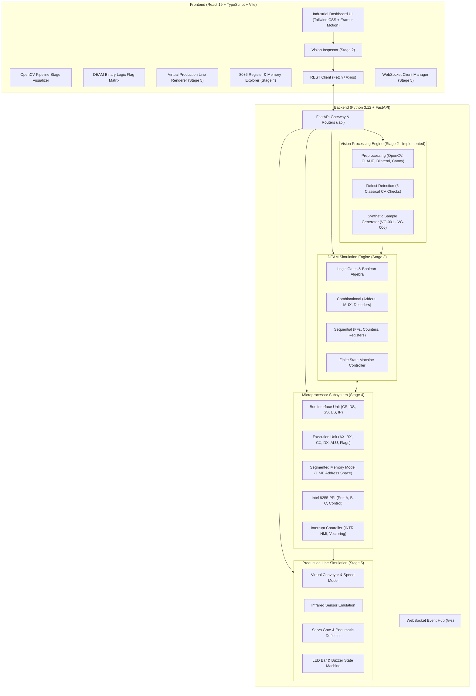

# VisionGuard 2.0: System Architecture Specification

## 1. Architectural Overview
VisionGuard 2.0 employs a decoupled client-server architecture engineered for high fidelity hardware-software co-simulation and educational transparency.

---

## 2. Implemented Computer Vision Engine (Stage 2)

### 2.1 Standardized Industrial Product Model
- **Product**: Rectangular Electronic Control Module (Casing: $400 \times 300$ px on $640 \times 480$ px neutral canvas).
- **Casing**: Dark industrial slate (`RGB (50, 55, 60)`) with 4 corner mounting screws.
- **Identification Label**: White rectangular zone ($150 \times 80$ px) with simulated barcode patterns (`RGB (250, 252, 255)`).
- **Identification Marking**: Circular badge ($r=28$ px) specified in Industrial Blue (`HSV H: [95, 135]`).
- **Electronic Components**: 3 cylindrical PCB terminal components mounted along the lower casing row ($y=300$).
- **Structural Outline**: Fixed rectangular footprint with solidity $> 0.985$, rectangularity $> 0.985$, and 4 polygon vertices.
- **Surface Quality**: Clean casing surface evaluated outside label, marking, and component exclusion zones.

### 2.2 Classical Computer Vision Algorithms
| Check | Algorithm | Measured Metrics & Threshold |
|---|---|---|
| **A. Product Detection** | Binary inverse thresholding + outer contour detection | Area $50,000 \le A \le 240,000$ px; Centered within ROI |
| **B. Label Verification** | ROI cropping + luminance mean extraction | Mean luminance $\ge 200.0$ / 255 |
| **C. Marking Colour** | BGR to HSV conversion + inRange blue mask | Blue pixels $\ge 800$ in marking circle |
| **D. Component Inspection** | Multi-ROI luminance contrast + Canny edge density | Mean brightness $\ge 78.0$ and edge density $\ge 0.040$ |
| **E. Structural Outline** | Contour area vs bounding rect + Convex hull solidity + approxPolyDP | Solidity $\ge 0.985$, Rect $\ge 0.985$, Vertices $= 4$, Aspect ratio $\in [1.25, 1.42]$ |
| **F. Surface Scratch** | Contour-eroded exclusion mask + dark feature threshold + arc length | Max scratch length $< 26.0$ px and scratch area $< 40$ px |

---

## 3. Implemented REST API Endpoints

- `GET /api/health`: Health status & stage verification.
- `GET /api/samples`: List all 6 synthetic sample specifications with metadata.
- `GET /api/samples/{sample_id}/image`: Stream raw $640 \times 480$ benchmark JPEG image.
- `POST /api/inspection/analyze-sample`: Execute inspection on a synthetic sample (`{"sample_id": "VG-001"}`).
- `POST /api/inspection/analyze`: Multipart image upload (local JPG/PNG or webcam frame) executing full inspection.
- `GET /api/inspection/config`: Active inspection thresholds, HSV bounds, and ROI coordinates.
