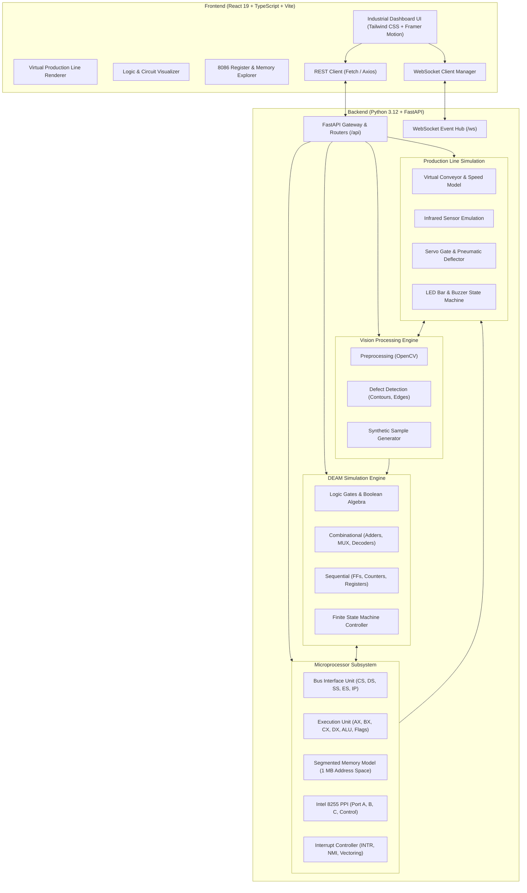

# VisionGuard 2.0: System Architecture Specification

## 1. Architectural Overview
VisionGuard 2.0 employs a decoupled client-server architecture engineered for high fidelity hardware-software co-simulation and educational transparency.



---

## 2. Directory Structure & Modular Breakdown

### 2.1 Backend Architecture (`backend/app/`)
```
backend/
├── app/
│   ├── __init__.py
│   ├── main.py                  # Application entry point, CORS, and WebSocket router
│   ├── api/                     # REST API routing endpoints
│   │   ├── __init__.py
│   │   ├── health.py            # System health check (Stage 1)
│   │   ├── inspection.py        # Vision trigger & result endpoints (Stage 2)
│   │   ├── simulation.py        # Production line cycle step/run/reset (Stage 5)
│   │   └── samples.py           # Sample image serving & catalog (Stage 2)
│   ├── vision/                  # OpenCV-based defect detection
│   │   ├── __init__.py
│   │   ├── preprocessing.py     # Grayscale, blur, threshold, CLAHE
│   │   ├── defect_detection.py  # Dimensional, scratch, crack detection algorithms
│   │   └── synthetic_samples.py # Procedural generation of clean & flawed test units
│   ├── deam/                    # Digital Electronics & Logic Simulation
│   │   ├── __init__.py
│   │   ├── logic_gates.py       # AND, OR, NOT, NAND, NOR, XOR, XNOR
│   │   ├── boolean_logic.py     # Expression parser, truth tables, K-Map minimizer
│   │   ├── combinational.py     # Half/Full Adders, MUX (2:1, 4:1, 8:1), Decoders, Encoders
│   │   ├── sequential.py        # Clock generation and synchronous clock distribution
│   │   ├── flipflops.py         # SR, JK, D, T latch and edge-triggered models
│   │   ├── counters.py          # Asynchronous ripple & synchronous 4-bit/8-bit up-down
│   │   ├── registers.py         # SISO, SIPO, PISO, PIPO shift registers
│   │   └── fsm.py               # Mealy and Moore state machine controllers
│   ├── microprocessor/          # Intel 8086 & Peripherals Engine
│   │   ├── __init__.py
│   │   ├── cpu8086.py           # Core CPU loop, BIU/EU abstraction
│   │   ├── registers.py         # 16-bit registers (AX, BX, CX, DX, SI, DI, BP, SP, Flags)
│   │   ├── memory.py            # 1 MB segmented address space (Physical = Segment * 16 + Offset)
│   │   ├── instructions.py      # Instruction decoder & execution handlers
│   │   ├── ppi8255.py           # Intel 8255 PPI mode 0, 1, 2, BSR mode emulation
│   │   ├── interrupts.py        # IVT (Interrupt Vector Table), INTR, NMI, IRET
│   │   └── timers.py            # Timer counter simulation (8253/8254 concepts)
│   ├── simulation/              # Physical conveyor line & sorting integration
│   │   ├── __init__.py
│   │   ├── engine.py            # Discrete-event tick simulation engine
│   │   ├── conveyor.py          # Motor control, conveyor belt position kinematics
│   │   ├── servo_gate.py        # Rejection gate deflector angle interpolation
│   │   ├── sensors.py           # IR photoelectric detection trigger logic
│   │   └── production_line.py   # State orchestrator binding vision, logic & 8086
│   ├── models/                  # Pydantic schemas and serialization definitions
│   │   ├── __init__.py
│   │   └── schemas.py           # Request/response schemas for APIs and WS frames
│   ├── services/                # Business and orchestration services
│   │   ├── __init__.py
│   │   ├── inspection_service.py
│   │   └── simulation_service.py
│   └── tests/                   # Pytest test suite
```

### 2.2 Frontend Architecture (`frontend/src/`)
```
frontend/src/
├── assets/                      # Static icons, sample assets, schematics
├── components/                  # Reusable UI widgets
│   ├── common/                  # Buttons, Badges, Cards, Modals, Progress bars
│   ├── layout/                  # Header, Navigation, Status bar, Split panes
│   ├── production_line/         # Interactive conveyor canvas, sensor diodes, gate arm
│   ├── deam_view/               # Gate schematics, truth tables, K-map tables, FSM graph
│   ├── cpu_view/                # 8086 register grid, memory segment viewer, flag register
│   └── vision_view/             # Live camera/uploaded image canvas with defect overlays
├── services/                    # API and WebSocket communication
│   ├── api.ts                   # Fetch API wrappers with typed error handling
│   └── websocket.ts             # Auto-reconnecting WebSocket client
├── types/                       # Shared TypeScript interface definitions
│   └── index.ts
├── App.tsx                      # Main application view container
└── main.tsx                     # React root mount and providers
```

---

## 3. Communication Protocols

### 3.1 REST API
- `GET /api/health`: Immediate status and stage verification.
- `GET /api/samples`: Retrieve pre-configured synthetic sample catalogue.
- `POST /api/inspect`: Trigger manual single-frame inspection with customizable detection parameters.
- `POST /api/simulation/start|pause|step|reset`: Discrete-time simulator control.

### 3.2 WebSockets (`/ws/simulation`)
Real-time high frequency simulation state streaming:
```json
{
  "timestamp": 1731940000.12,
  "conveyor": { "position": 142.5, "speed": 12.0, "status": "STOPPED" },
  "sensor": { "ir_active": true, "beam_interrupted": true },
  "vision": { "processing": false, "decision": "REJECT", "defect_type": "SURFACE_CRACK" },
  "logic": { "gate_inputs": [1, 0], "gate_output": 0, "fsm_state": "S_DEFECT_DETECTED" },
  "cpu8086": { "ip": "0x0120", "ax": "0x0001", "flags": { "ZF": 0, "CF": 0, "IF": 1 } },
  "actuators": { "gate_angle": 45.0, "bin": "REJECT_BIN", "led": "RED", "buzzer": true },
  "counters": { "total": 42, "passed": 36, "rejected": 6 }
}
```

---

## 4. Hardware Simulation Precision
The digital electronic blocks operate on discrete logic states (`0`, `1`, `X` undefined). Sequential elements evaluate synchronously on rising/falling clock edges. The 8086 CPU executes opcode fetch-decode-execute cycles against an educational instruction subset matching Intel 8086 machine semantics.
