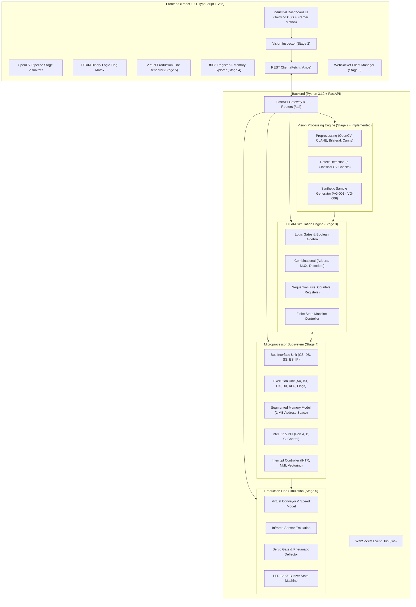

# VisionGuard 2.0: System Architecture Specification

## 1. Architectural Overview
VisionGuard 2.0 employs a decoupled client-server architecture engineered for high fidelity hardware-software co-simulation and educational transparency.

---

## 2. Implemented Computer Vision Engine (Stage 2)

### 2.1 Standardized Industrial Product Model
- **Product**: Rectangular Electronic Control Module (Casing: $400 \times 300$ px on $640 \times 480$ px neutral canvas).
- **Casing**: Dark industrial slate (`RGB (50, 55, 60)`) with 4 corner mounting screws.
- **Identification Label**: White rectangular zone ($150 \times 80$ px) with simulated barcode patterns (`RGB (250, 252, 255)`).
- **Identification Marking**: Circular badge ($r=28$ px) specified in Industrial Blue (`HSV H: [95, 135]`).
- **Electronic Components**: 3 cylindrical PCB terminal components mounted along the lower casing row ($y=300$).
- **Structural Outline**: Fixed rectangular footprint with solidity $> 0.985$, rectangularity $> 0.985$, and 4 polygon vertices.
- **Surface Quality**: Clean casing surface evaluated outside label, marking, and component exclusion zones.

### 2.2 Classical Computer Vision Algorithms
| Check | Algorithm | Measured Metrics & Threshold |
|---|---|---|
| **A. Product Detection** | Binary inverse thresholding + outer contour detection | Area $50,000 \le A \le 240,000$ px; Centered within ROI |
| **B. Label Verification** | ROI cropping + luminance mean extraction | Mean luminance $\ge 200.0$ / 255 |
| **C. Marking Colour** | BGR to HSV conversion + inRange blue mask | Blue pixels $\ge 800$ in marking circle |
| **D. Component Inspection** | Multi-ROI luminance contrast + Canny edge density | Mean brightness $\ge 78.0$ and edge density $\ge 0.040$ |
| **E. Structural Outline** | Contour area vs bounding rect + Convex hull solidity + approxPolyDP | Solidity $\ge 0.985$, Rect $\ge 0.985$, Vertices $= 4$, Aspect ratio $\in [1.25, 1.42]$ |
| **F. Surface Scratch** | Contour-eroded exclusion mask + dark feature threshold + arc length | Max scratch length $< 26.0$ px and scratch area $< 40$ px |

---

## 3. Implemented REST API Endpoints

- `GET /api/health`: Health status & stage verification.
- `GET /api/samples`: List all 6 synthetic sample specifications with metadata.
- `GET /api/samples/{sample_id}/image`: Stream raw $640 \times 480$ benchmark JPEG image.
- `POST /api/inspection/analyze-sample`: Execute inspection on a synthetic sample (`{"sample_id": "VG-001"}`).
- `POST /api/inspection/analyze`: Multipart image upload (local JPG/PNG or webcam frame) executing full inspection.
- `GET /api/inspection/config`: Active inspection thresholds, HSV bounds, and ROI coordinates.
- `GET /api/deam/*`: DEAM logic gates, Boolean logic, K-Map, combinational, sequential, and FSM endpoints.
- `GET /api/microprocessor/status`: 8086 CPU & 8255 PPI operational capabilities and architecture features.
- `GET /api/microprocessor/examples`: Preloaded assembly demo programs catalog.
- `POST /api/microprocessor/sessions/{session_id}`: Create or get state for an 8086 virtual CPU session.
- `POST /api/microprocessor/sessions/{session_id}/reset`: Reset CPU registers, queue, and bus to power-on state.
- `POST /api/microprocessor/sessions/{session_id}/load`: Assemble and load 8086 assembly code into memory.
- `POST /api/microprocessor/sessions/{session_id}/step`: Single-step instruction execution with EU/BIU trace.
- `POST /api/microprocessor/sessions/{session_id}/run`: Continuous execution loop until HLT or step limit.
- `POST /api/microprocessor/sessions/{session_id}/memory`: Segmented memory dump with physical addresses.
- `GET /api/microprocessor/sessions/{session_id}/stack`: Stack memory inspect at `SS:SP`.
- `GET /api/microprocessor/sessions/{session_id}/ppi`: Intel 8255 PPI ports and actuator decoded states.
- `POST /api/microprocessor/sessions/{session_id}/ppi/configure`: Configure 8255 PPI Control Word.
- `POST /api/microprocessor/sessions/{session_id}/ppi/write`: Write byte to Port A, B, or C.
- `POST /api/microprocessor/sessions/{session_id}/ppi/import-vision`: Map OpenCV flags into Port A (80H).
- `POST /api/microprocessor/sessions/{session_id}/ppi/import-sample`: Map synthetic sample flags into Port A.
- `POST /api/microprocessor/sessions/{session_id}/interrupts/raise`: Inject NMI or INTR interrupt.
- `POST /api/microprocessor/sessions/{session_id}/timer/configure`: Configure 8253 PIT mode and initial count.
- `POST /api/microprocessor/sessions/{session_id}/timer/tick`: Advance 8253 PIT clock ticks and evaluate IRQ0.

---

## 4. Intel 8086 Microprocessor & 8255 PPI Subsystem (Stage 4)

### 4.1 8086 Register Architecture & Aliasing
- **16-bit General Purpose**: `AX`, `BX`, `CX`, `DX`
- **8-bit Byte Aliases**: `AH/AL`, `BH/BL`, `CH/CL`, `DH/DL` with bitwise synchronization (`AX = (AH << 8) | AL`).
- **Pointers & Indices**: `SP` (Stack Pointer), `BP` (Base Pointer), `SI` (Source Index), `DI` (Destination Index).
- **Segment Registers**: `CS` (Code Segment), `DS` (Data Segment), `SS` (Stack Segment), `ES` (Extra Segment).
- **Instruction Pointer**: `IP` (16-bit).
- **Status & Control Flags**: 9 active bits: `CF` (Carry), `PF` (Parity), `AF` (Auxiliary Carry), `ZF` (Zero), `SF` (Sign), `TF` (Trap), `IF` (Interrupt Enable), `DF` (Direction), `OF` (Overflow).

### 4.2 Segmented Memory & 20-bit Addressing
- **Total Address Space**: 1 MB ($2^{20} = 1,048,576$ bytes, addresses `00000H` - `FFFFFH`).
- **Address Generation**: $\text{Physical Address} = (\text{Segment} \ll 4) + \text{Offset}$.
- **Endianness**: Little-Endian (low-order byte at lower address, high-order byte at higher address).

### 4.3 Bus Interface Unit (BIU) & Execution Unit (EU)
- **BIU**: Autonomous 6-byte instruction prefetch FIFO queue. Prefetches upcoming instruction bytes during idle bus cycles.
- **Queue Flushing**: Cleared and refilled automatically upon branch instructions (`JMP`, `JZ`, `JNZ`, `JC`, `JNC`, `LOOP`, `CALL`, `RET`, `IRET`).
- **EU**: Decodes prefetched opcodes, computes effective addresses, executes ALU operations, updates flags, and asserts control bus signals (`ALE`, `MEMR`, `MEMW`, `IOR`, `IOW`, `DEN`, `DT/R`).

### 4.4 Intel 8255 PPI Interfacing
- **Port Mapping**:
  - Port A (`80H`): 8-bit Input from OpenCV inspection sensors ($D, S, C, L, M, G$).
  - Port B (`81H`): 8-bit Output to sorting actuators (PB0: Conveyor, PB1: Reject Gate, PB2: Green LED, PB3: Red LED, PB4: Buzzer).
  - Port C (`82H`): Split into $PC_{upper}$ and $PC_{lower}$ for handshaking and status telemetry.
  - Control Word (`83H`): Mode 0, Mode 1, and Bit Set/Reset (BSR) configuration.

